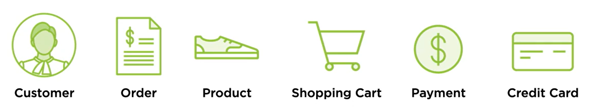
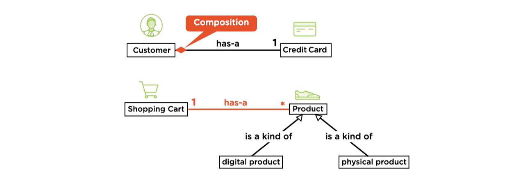
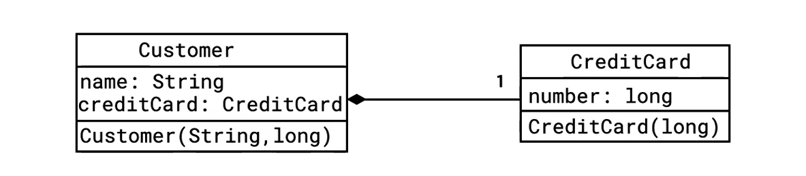
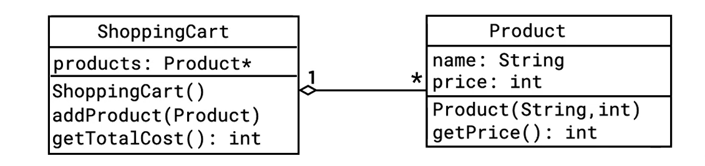

### OOP

<br/>

#### What is Object Orientation?
Based on objects, consist of
- State (data, held in fields)
- Behavior (methods, functions)

An OO program is a collection of objects working together.

<br/>

#### Why Object Orientation?
- Almost universal in the software industry
- Useful for analysis, design, and coding
- Most successful for managing complexity
  - Supports decoupling of subsystem
  - Encourage reuse of components
- Design rationale for much of Java language

<br/>

#### What's wrong with Global Data Structures
- Responsibility for state becomes spread out
- Different subsystems are coupled together
- Difficulty representing varied data formats
- Extremely difficult to parallelize

<br/>

#### Use Cases
A stories or scenarios written in natural language, English.
- Scenarios of system operation.
- Often started by human user
- List the sequence of interaction steps

```text
"Order control system designed to a web e-shopping site"
Use Case:
- Create Order & Checkout
```

```text
"A Customer creates an order by first adding various product (digital or physical)
to a shopping cart, then check out, making a payment using a credit card."
Use Case:  
- Fulfill Order (process of packing, dispatching & delivery)
```

<br/>

#### Top Level Design
```text
Use Cases 
⬇️
Domain Model (consist of Conceptual Classes)
⬇️
Software Classes


Notes:
Domain model - represents real world entities(conceptual classes)
```

<br/>

#### Discovering Conceptual Classes
- To identify conceptual classes
  - identify nouns and noun phrases in the use case description.

```text
"A Customer creates an order by first adding various product (digital or physical)
to a shopping cart, then check out, making a payment using a credit card."

- Customer, Order, Product, Shopping Cart, Payment, Credit Card.
```


<br/>

#### Class Relations
Relationship of classes to another  


<br/>

#### Software Classes


```java
public class Customer {
    private final String name:
    private CreditCard creditCard;
    
    public class Customer(String name, long ccNumber){
        this.name = name;
        this.creditCard = new CreditCard(ccNumber);
    }
}
```

```java
class CreditCard{
    private final long cardNumber;
    CreditCard(long cardNumber) {
        this.cardNumber = cardNumber;
    }
}
```


```java
public class Product {
    private final String name;
    private int price;
    
    public Product(String name, int price){
        this.name = name;
        this.price = price;
    }
    public int getPrice(){
        return price;
    }
}
```

```java
import java.util.ArrayList;

public class ShoppingCart {
  private List<Product> products = new ArrayList<>();
  
  public void addProduct(Product product){
      products.add(product)
  }
  
  public int getTotalCost(){
      return products.stream()
              .mapToInt(Prduct::getPrice)
              .sum();
  }
}
```